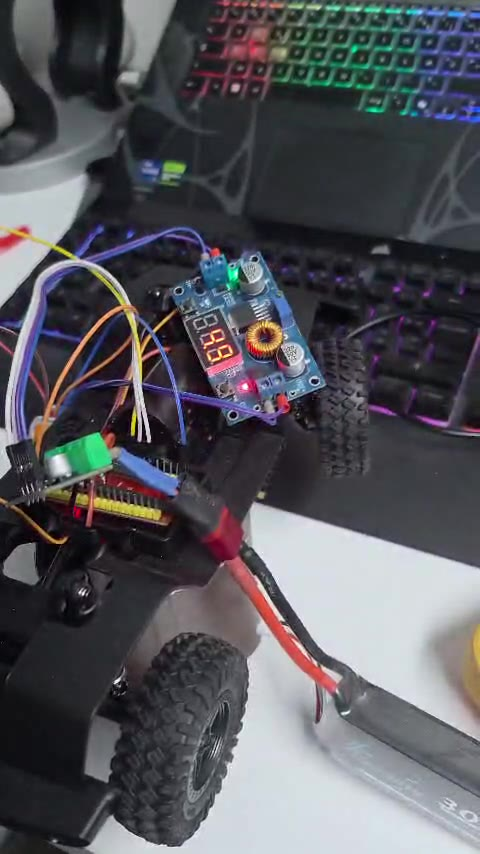

# NITRO — voiture radiocommandée ESP32

Projet de groupe ESIEE-IT (2026–2027) : une voiture radiocommandée **et sa manette**, construites de A à Z autour de deux cartes ESP32 qui se parlent en direct, sans box Internet.

**▶ Site du projet (jeu 3D) : https://medouaishamdi.github.io/nitro/**
**▶ Présentation : [PDF](presentation/NITRO-presentation.pdf) · [PowerPoint](presentation/NITRO-presentation.pptx)**

Équipe (ordre alphabétique) : Aymen Ellili · Mohamed Ouais Hamdi · Eya Moalla · Oussama Taieb



## Le principe

| | |
|---|---|
| Liaison | ESP32 → ESP32 en direct (Wi-Fi sans routeur), la manette reconnaît la voiture par son identifiant unique |
| Fréquence | 20 commandes par seconde (direction + vitesse) |
| Moteur | Le **DRV8871** est un **hacheur** : il découpe très vite la tension de la batterie pour contrôler le moteur arrière |
| Énergie | Batterie 7,4 V : chemin 1 vers le moteur arrière (via le hacheur DRV8871), chemin 2 via un abaisseur réglé à 5 V (4,99 V mesurés) pour l'ESP32 et le servomoteur |
| Manette | ESP32, deux joysticks (gauche = direction, droite = vitesse), écran LCD 20×4 « DIR \| GAZ », conduite progressive |

### Arrêt au stand
La première carte moteur, une **L298N**, chauffait et perdait de la puissance : elle a été remplacée par un **DRV8871**, un hacheur plus moderne et plus efficace qui contrôle le moteur.

## Avancement

**Fait (11 / 20 tâches, 55 %)**
- Voiture : ESP32, hacheur DRV8871 pour le moteur, servomoteur de direction, double alimentation 7,4 V / 5 V, code angle + vitesse, la voiture avance et tourne
- Manette : ESP32 + 2 joysticks, écran DIR | GAZ, conduite progressive à 20 envois/s
- Liaison directe ESP32 → ESP32 par identifiant unique

**À faire**
- Marche arrière, LED (clignotants jaunes, feux rouges de recul), klaxon
- Coque de la voiture ; finir la coque de la manette (imprimée en 3D, en cours)
- Base de données (sessions, télémétrie, événements) et calcul de la vitesse
- Relier le site à la base de données

## Le site : NITRO Arena

Le projet présenté sous forme de jeu de football 3D dans le navigateur (Three.js) :
- un but dans la cage **orange** affiche ce qui est fait, un but contre son camp (cage **bleue**) ce qu'il reste à faire ;
- cercles au sol (on s'arrête dessus, puis touche **O**) : projet, architecture, télémétrie, équipe, atelier photos ;
- l'écran géant du stade diffuse la vraie voiture en vidéo, avec un replay après chaque but ;
- l'écran en bas à gauche reproduit l'écran LCD de la vraie manette ;
- commandes : flèches / ZQSD, Maj = boost, H = klaxon ; sur téléphone, deux joysticks tactiles.

Base de données proposée pour l'évaluation finale :

```
sessions    (id, date, pilote, duree_s)
telemetrie  (session_id, t_ms, vitesse_pct, angle_deg, batterie_v)
evenements  (session_id, t_ms, type)   -- klaxon, clignotant, recul, but
```

## Contenu du dépôt

```
index.html            le site (un seul fichier, Three.js chargé depuis cdnjs)
data/tasks.json       la liste des tâches affichée par le site
media/                photos et vidéos du prototype
presentation/         la présentation (PowerPoint avec transitions Morph, et PDF)
```

Pour l'ouvrir en local : `python -m http.server` dans ce dossier, puis http://localhost:8000.

---

*English summary — NITRO is an ESIEE-IT group project: a remote-controlled car and its custom controller, built around two ESP32 boards talking directly to each other (20 commands per second, the motor driven by a DRV8871 chopper, dual 7.4 V / 5 V power). The project website is a 3D football game: scoring in each goal reveals what is done or what is left to do.*
